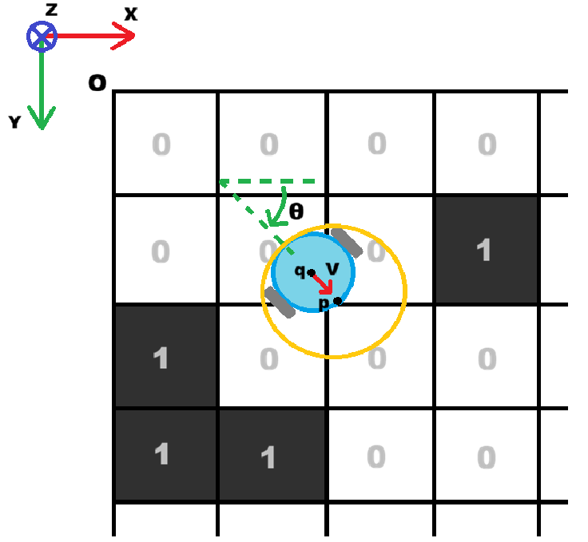

# Carte

Mathias Bouchut--Loubet
24/11/2026

## Introduction

Ce document décrit les informations relatives à la carte du terrain ainsi que la manière dont celle-ci est représentée dans le projet.

La carte est un élément central du projet. Elle permet de représenter l'environnement dans lequel évoluent les robots, notamment les obstacles et les limites de la zone accessible.
La carte est définie directement dans le code, au sein de la classe `Map`.

## Classe Map

La classe `Map` centralise les différentes informations relatives à la carte.

<div align="center">

</div>

### Représentation de la carte

La carte est représentée par un tableau NumPy à deux dimensions, stocké dans la variable `Map.MAP_TABLE`.

Chaque cellule du tableau représente une zone du terrain et peut prendre deux valeurs :

- `0` : zone libre, accessible aux robots.
- `1` : obstacle, zone non accessible aux robots.

Il est possible d'accéder à une cellule du tableau à l'aide de la notation suivante :

```python
Map.MAP_TABLE[a, b]
```

Où :
- `a` correspond à la coordonnée X dans le tableau.
- `b` correspond à la coordonnée Y dans le tableau.

### Dimensions de la carte

Deux variables permettent de connaître directement les dimensions du tableau :

- `Map.X` : nombre de cellules dans la direction X.
- `Map.Y` : nombre de cellules dans la direction Y.

Ces deux grandeurs définissent uniquement les dimensions du tableau, exprimées en nombre de cellules. Elles ne correspondent pas directement aux dimensions réelles de la carte, qui sont exprimées en millimètres.

Les indices valides pour accéder aux cellules du tableau sont donc :

- `a ∈ [0, Map.X - 1]`
- `b ∈ [0, Map.Y - 1]`

### Échelle de la carte

Le tableau constitue une représentation discrétisée de l'environnement réel. Chaque cellule correspond à une surface carrée dont les dimensions sont définies dans le monde réel.

La variable `Map.SIZE` définit cette correspondance. Elle représente la longueur réelle d'un côté d'une cellule, exprimée en **mm/cellule**.

À partir de cette échelle, il est possible de déterminer les dimensions réelles de la carte :

- **Longueur selon X :** `Map.X * Map.SIZE` (en mm).
- **Longueur selon Y :** `Map.Y * Map.SIZE` (en mm).

Cette échelle permet également de convertir les coordonnées exprimées en indices de tableau (cellules) en coordonnées réelles (millimètres), et inversement.
